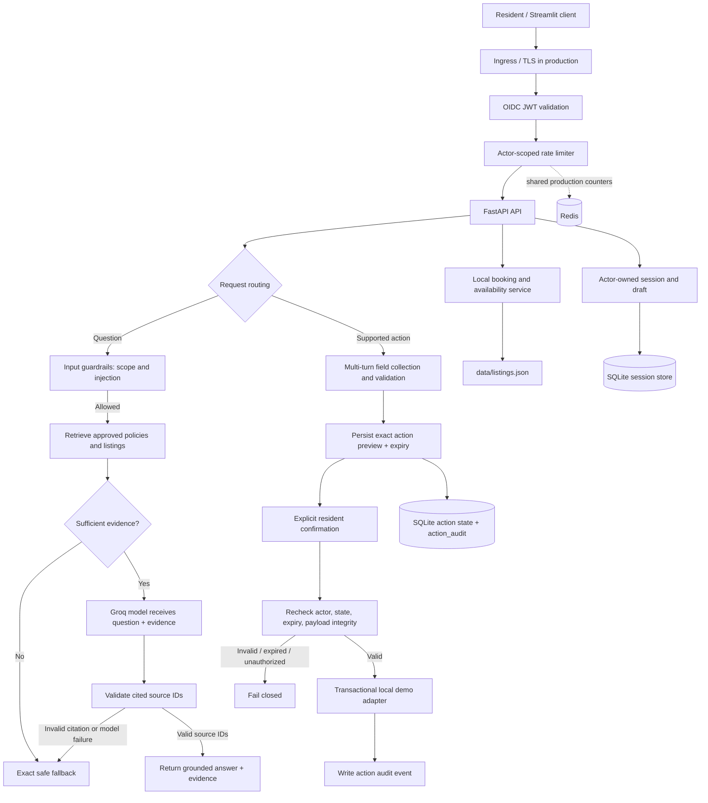
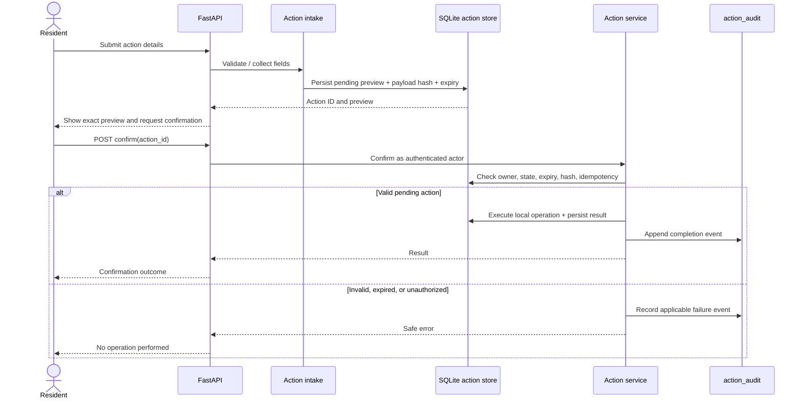

# Architecture — Hmlet Resident Assistant

## Purpose and core design decision

This project is a resident-support assistant prototype. It answers questions from approved policy and listing data,
declines unsupported requests, and supports a small set of confirmation-gated resident actions.

**The model never executes state-changing operations.** It helps interpret a request and generate an evidence-grounded
answer; deterministic application code validates action details, authorizes the actor, manages state transitions, and
performs the local demo operation only after explicit confirmation.

## Where the four assignment guardrails live

| Guardrail                                    | Main implementation                                                              | Regression coverage                                                                                                                      |
|----------------------------------------------|----------------------------------------------------------------------------------|------------------------------------------------------------------------------------------------------------------------------------------|
| Scope control                                | `app/assistant/guardrails.py`, `app/assistant/service.py`                                          | `tests/test_guardrails_adversarial.py`, `tests/test_assistant.py`; `eval/run_security_eval.py`                                           |
| Grounded answers and safe fallback           | `app/knowledge/retrieval.py`, `app/assistant/grounding.py`, `app/assistant/service.py`                       | `tests/test_claim_grounding.py`, `tests/test_assistant.py`; `eval/run_retrieval_eval.py`                                                 |
| Prompt-injection and private-data resistance | `app/assistant/guardrails.py`, approved-source boundary in `app/knowledge/retrieval.py`              | `tests/test_guardrails_adversarial.py`; `eval/run_security_eval.py`                                                                      |
| Explicit action confirmation                 | `app/actions/intake.py`, `app/actions/service.py`, `app/bookings/service.py`, `app/api.py` | `tests/test_action_intake.py`, `tests/test_actions.py`, `tests/test_booking_service.py`, `tests/test_api.py`, `tests/test_end_to_end.py` |

Pattern and keyword checks are defense in depth, not a complete semantic security boundary. The strongest private-data
control is architectural: `data/support_tickets.json` is deliberately **not loaded into the knowledge index**, so its
contents are not included in model context.

## Component and guardrail flow

The diagram describes the logical request path. In the current FastAPI implementation, request-observability middleware
assigns or validates the request ID before route handling. The rate limiter is applied during request handling after
actor/session checks in the relevant route; it is not a separate network gateway. Production ingress and TLS are
deployment responsibilities, not implemented by this local app.

## Main request flows

### Knowledge question

1. A client creates a session through `POST /v1/sessions`. The actor comes from a verified OIDC JWT when authentication
   is enabled; the client cannot choose another actor ID.
2. The client sends `POST /v1/sessions/{session_id}/messages`. The API checks that the session belongs to the
   authenticated actor and applies rate limiting.
3. The assistant applies deterministic input checks for known out-of-scope or suspicious requests.
4. Retrieval searches approved policy and listing fixtures. Private support tickets are excluded from the index.
5. If evidence is insufficient, the assistant returns the exact fallback: `I do not have that information.` Otherwise,
   the model is given the retrieved evidence to draft an answer.
6. Source IDs in the response are validated against the evidence supplied for that turn. A model error or invalid
   citation fails closed to the safe fallback / controlled error path. Valid source IDs are not, by themselves, proof
   that every claim is entailed; claim-grounding checks are diagnostic rather than a hard semantic gate.
7. The API returns the answer, evidence, status, optional action preview, and request ID. Message bodies are not
   persisted in session metadata.

### Booking and availability

- `GET /v1/availability` searches the local `data/listings.json` catalog by supported filters such as city, move-in
  date, and stay length.
- `GET /v1/bookings` returns local-demo bookings for the authenticated actor only.
- Natural-language booking intake collects the listing, move-in date, and stay length. The service checks the local
  catalog and returns a preview with published pricing and deposit details when available.
- Creating a booking requires explicit confirmation. The confirmed demo record is persisted locally. Cancellation
  selects from the actor's own active bookings and then uses a preview/confirmation workflow.
- These endpoints do not connect to live Hmlet inventory. No external reservation system is updated, and local catalog
  status cannot guarantee that a real unit is available.

### Confirmation and execution

1. Action intake validates the requested action and collects required fields over multiple turns.
2. The action service persists a preview with an action ID, payload hash, status, and expiry.
3. The resident explicitly confirms or declines the exact preview.
4. On confirmation, the service rechecks actor ownership, pending state, expiry, and payload integrity before executing.
5. The SQLite schema uses unique action IDs and unique idempotency keys; action records also constrain a maintenance
   request to one row per action. Transactional state transitions and persisted results make repeated confirmations
   replay-safe for the local adapter.
6. An audit event is written to `action_audit` for action lifecycle events. Audit records include the actor, action,
   event, details, and timestamp. They do not currently provide a guaranteed join to the HTTP request ID.
7. Expired, altered, unknown, or unauthorized actions fail closed rather than executing.

## API and UI

The FastAPI application is exposed as `app.api:app`.

| Method | Endpoint                                                | Purpose                                                                 |
|--------|---------------------------------------------------------|-------------------------------------------------------------------------|
| `GET`  | `/health`                                               | Liveness check                                                          |
| `GET`  | `/ready`                                                | Checks required model configuration; not a full dependency-health check |
| `POST` | `/v1/sessions`                                          | Create an actor-scoped session                                          |
| `GET`  | `/v1/availability`                                      | Search the local listing catalog                                        |
| `GET`  | `/v1/bookings`                                          | List local-demo bookings for the authenticated actor                    |
| `POST` | `/v1/sessions/{session_id}/messages`                    | Submit a resident message                                               |
| `POST` | `/v1/sessions/{session_id}/actions/{action_id}/confirm` | Confirm a pending action                                                |
| `POST` | `/v1/sessions/{session_id}/actions/{action_id}/decline` | Decline a pending action                                                |

`streamlit_app.py` is an API client that displays answers, evidence, status, booking details, and action previews, with
explicit confirm/decline controls. It does not instantiate the assistant directly or bypass backend authorization.

## Data boundaries and persistence

- **Indexed:** approved resident policy text from `data/house_rules.md` and structured housing listings from
  `data/listings.json`.
- **Never indexed:** `data/support_tickets.json`. Ticket contents are not passed to the LLM as retrieval evidence.
  Requests for another resident's private ticket should be refused; this boundary does not depend solely on detecting a
  particular phrase.
- **Session state:** session ownership and multi-turn draft metadata are stored in SQLite using `RESIDENT_SESSION_DB`.
  The API does not persist message bodies in session metadata.
- **Action state:** pending action payloads, status, idempotency data, results, and `action_audit` events are stored in
  SQLite using `RESIDENT_ACTION_DB`.
- **Booking demo data:** the booking service reads the approved listing fixture and stores confirmed demo booking
  details in the local action database.
- **Rate limits:** Redis provides shared counters when configured. The in-process fallback is for development and tests
  only.

SQLite is appropriate for a single-machine take-home demonstration. A multi-instance deployment needs shared
transactional storage, schema migrations, backup/restore, retention policies, and concurrency tests.

## Authentication and authorization

- Protected API requests validate OIDC JWT signatures and configured JWKS, issuer, audience, and time/subject claims.
- Actor identity is derived from the verified token, never from an arbitrary request-body field.
- Session and booking queries are actor-scoped.
- Action confirmation and decline are checked against the authenticated actor and stored action state.
- Unknown and unauthorized session access intentionally return the same not-found response to avoid disclosing session
  existence.
- Local authentication bypass, when enabled for a local demo, uses a fixed development identity and must never be
  enabled in a shared or production environment.

Production requires integration tests against the real identity provider and explicit mapping of the provider's claims
to resident identity and permissions.

## Reliability, audit, and observability

- LLM inference uses bounded timeout/retry settings. If the model provider remains unavailable, the API returns a
  controlled temporary-failure response rather than treating the failure as a grounded answer.
- State-changing operations are not blindly retried. Persisted idempotency keys and action state protect the local
  confirmation flow from duplicate execution.
- Redis is required when configured for distributed rate limiting. If Redis is configured but unreachable during limiter
  initialization, startup fails rather than silently switching to a per-process limiter. In production mode, `REDIS_URL`
  is required.
- SQLite connections use a busy timeout; sustained lock contention can still cause an operation to fail and should be
  handled by the caller. SQLite is not the intended multi-instance production store.
- Request middleware emits request IDs and HTTP timing/status logs through Python's standard logging system. The
  application does not currently configure a complete logging pipeline at startup, and request IDs are not persisted in
  `action_audit`; therefore cross-layer correlation is best-effort rather than guaranteed.
- The `action_audit` table is a durable record of action lifecycle events, distinct from HTTP access logs. It is not a
  substitute for centralized monitoring, alerting, or tamper-resistant audit storage.
- Rate limiting returns HTTP 429 when the configured limit is exceeded.
- `/health` is a liveness check. `/ready` checks model configuration and is not a comprehensive check of Groq, Redis, or
  SQLite availability.

## Failure modes

| Failure                                             | Current behavior                                                                                                                                             | Production follow-up                                                                    |
|-----------------------------------------------------|--------------------------------------------------------------------------------------------------------------------------------------------------------------|-----------------------------------------------------------------------------------------|
| Groq timeout or provider failure                    | Bounded retries/timeouts; controlled failure response or safe fallback depending on call path. No action is executed because an LLM call fails.              | Alert on error rates; test provider outages and retry budgets.                          |
| Missing retrieval evidence / invalid citation       | Return the exact safe fallback rather than an unsupported policy answer.                                                                                     | Expand adversarial and grounding evaluation.                                            |
| Redis unavailable when configured                   | Limiter initialization fails; no silent downgrade to process-local limits.                                                                                   | Health-check and monitor Redis; define deployment recovery policy.                      |
| SQLite lock contention                              | Connections wait up to the configured busy timeout; continued contention may fail the request.                                                               | Move to shared transactional storage and test concurrent load.                          |
| Two confirmations race                              | Action state and idempotency constraints protect against duplicate execution; a repeated completed confirmation returns the stored outcome where applicable. | Add concurrent stress tests and preserve atomic transitions in the production database. |
| Action expired, modified, or owned by another actor | Confirmation is rejected; no side effect is performed.                                                                                                       | Keep authorization checks in the trusted service layer.                                 |

## Design trade-offs

| Choice                                                     | Why it fits this take-home                                                                       | Limitation / next step                                                                 |
|------------------------------------------------------------|--------------------------------------------------------------------------------------------------|----------------------------------------------------------------------------------------|
| LLM for language; deterministic services for state changes | Keeps authorization and execution out of model-generated text.                                   | Expand supported intents only with explicit schemas and tests.                         |
| Lexical retrieval over approved fixtures                   | Simple, transparent, and reproducible.                                                           | Measure recall before considering hybrid/vector retrieval.                             |
| Source-ID validation                                       | Prevents citations to unknown evidence IDs.                                                      | Valid IDs do not prove claim entailment.                                               |
| Claim-grounding diagnostic                                 | Flags potential unsupported claims for evaluation.                                               | Heuristic only; not a semantic proof or hard safety gate.                              |
| SQLite adapters                                            | Easy local setup and test isolation.                                                             | Replace with shared transactional storage before multi-instance deployment.            |
| Streamlit API client                                       | Lets reviewers exercise the actual API.                                                          | Not a production resident UI; token and browser-session handling need security review. |
| Local booking adapter                                      | Demonstrates availability, booking preview, confirmation, and actor-scoped listing/cancellation. | Does not reserve real inventory or update an external system.                          |

## Production readiness work

1. Replace local SQLite stores with the resident platform's shared transactional database and migrations.
2. Integrate real maintenance and booking systems with authenticated APIs, inventory revalidation at commit time,
   idempotency, reconciliation, and auditable outcomes.
3. Configure the real OIDC provider, role/scope mapping, TLS, and secrets management.
4. Require distributed rate limiting and configure `APP_ENV=production`.
5. Add a configured logging/metrics/tracing pipeline, alerts, SLOs, request-size limits, and operational runbooks.
   Decide explicitly whether request IDs should be added to audit events.
6. Run integration and load tests against real infrastructure, test simultaneous confirmation requests, and conduct a
   privacy/security review.
